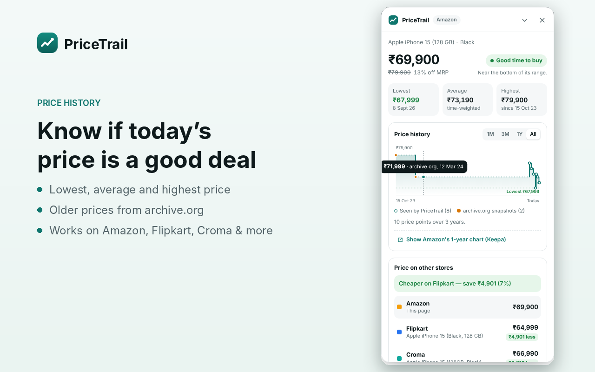

# PriceTrail

[](https://github.com/karan2905sharma/pricetrail/actions/workflows/ci.yml)
[](https://github.com/karan2905sharma/pricetrail/releases/latest)
[](LICENSE)

**Price history and store comparison for Indian shopping sites**, as a Chrome extension. Open a product on Amazon.in, Flipkart, Croma or Reliance Digital and PriceTrail shows how its price has moved, whether today's price is a good deal, and which store sells it for less.



## Features

- **Price history chart** with lowest, average and highest price and a verdict ("Good time to buy", "Price is high", …)
- **Older prices from archive.org**: the first time you open a product, PriceTrail reads archived copies of its page, so many products have history from day one
- **Compare stores**: Amazon.in, Flipkart, Croma and Reliance Digital (plus Tata CLiQ, Myntra, AJIO), matched by exact variant
- **Track & alert**: set a target price; tracked products are re-checked every few hours and you get a notification when they drop
- **Keepa's 1-year chart** for Amazon products, on demand
- **Private**: no account, no server, no analytics; everything stays in your browser ([privacy policy](PRIVACY.md))

## Install

### From the Chrome Web Store (automatic updates)

Coming soon. Once it's listed, the link will be here, and Chrome will keep it up to date automatically.

### From GitHub

1. Download `pricetrail-vX.Y.Z.zip` from the [latest release](https://github.com/karan2905sharma/pricetrail/releases/latest).
2. Unzip it into a folder you'll keep (for example `Documents/PriceTrail`).
3. Open `chrome://extensions`, turn on **Developer mode** (top right) and click **Load unpacked**.
4. Choose the unzipped folder, then pin PriceTrail from the puzzle-piece menu.

Works in Chrome 116+ and other Chromium browsers (Edge, Brave).

## Updating

- **Chrome Web Store install:** nothing to do. Chrome updates it for you.
- **GitHub install:** PriceTrail checks GitHub once a day and shows a banner in its popup (plus a notification) when a new version is out. To update:
  1. Download the new zip from the banner or the [releases page](https://github.com/karan2905sharma/pricetrail/releases/latest).
  2. Unzip it **over your existing PriceTrail folder**, replacing the files.
  3. On `chrome://extensions`, click the reload icon (↻) on PriceTrail.

  Your price history is kept: PriceTrail has a fixed extension ID, so it stays the same even if you unzip into a different folder.

Chrome doesn't let extensions installed with "Load unpacked" update themselves; that's why GitHub installs need these three steps.

## How it works

**Price history** comes from four places, all stored in `chrome.storage.local`:

1. **archive.org snapshots**: up to 14 archived copies of the product page, one per month, read once when you first open a product. Copies that show a captcha or a different variant are skipped. These appear as orange points.
2. **Your visits**: the price is recorded each time you open the product.
3. **Background checks** of products you track (every 3, 6, 12 or 24 hours).
4. **Comparisons**: prices seen on other stores are recorded for those products too.

Periods longer than 45 days with no price are drawn dashed, because the price in between isn't known.

**Comparison** turns the product title into a short search, reads the other stores' search results, and scores each result by title overlap. It penalises conflicting variants (128 GB vs 256 GB, Pro vs base, 15 vs 16e, phone vs case). Prices are read in layers so a shop redesign doesn't break everything at once:

1. Site-specific selectors
2. JSON-LD product data
3. Meta tags
4. Embedded page JSON
5. A ₹-pattern fallback

Croma's results come from its own search API. When a store blocks the request or returns no readable results, the panel shows a **Search ↗** link instead of a wrong price.

### Tested on the live sites (October 2026)

| Store | Product page | Search / compare |
|---|---|---|
| Amazon.in | ✅ | ✅ correct variant matched |
| Flipkart | ✅ via JSON-LD (its old price CSS classes are gone) | ✅ Pro models rejected |
| Croma | ✅ including its malformed JSON-LD | ✅ via Croma's search API |
| Reliance Digital | ✅ | ✅ |
| Tata CLiQ, Myntra, AJIO | not tested live (comparison off by default) | |

## Development

```bash
npm install
npm test                 # unit tests (jsdom, fixtures in tests/fixtures)
npm run test:e2e         # loads the real extension in Chromium against a local fake of every shop
npm run build            # dist/pricetrail-vX.Y.Z.zip (+ -webstore.zip without the manifest key)
```

The end-to-end test serves the fixture pages on `https://<shop>:443` and points Chromium at it. It needs `openssl`, Playwright's Chromium (`npx playwright install chromium`) and permission to use port 443. On Linux, run `sudo sysctl -w net.ipv4.ip_unprivileged_port_start=0` once.

```
extension/
  manifest.json
  background.js         service worker: storage, comparison, archive.org backfill, scheduled checks, alerts, update notices
  offscreen/            DOMParser for fetched pages
  content/              reads the product on the page; the on-page panel (Shadow DOM, SVG chart)
  popup/                tracked list, settings, backup, update banner
  lib/sites.js          store definitions; add a store here and in manifest.json
  lib/extract.js        price/title extraction for product and search pages
  lib/match.js          cross-store title matching
  lib/config.js         GitHub repo used for update notices
tests/                  unit + end-to-end tests and fixtures
scripts/                build, release, changelog helpers
store/                  Chrome Web Store images and listing text
```

If a store changes its pages and prices stop showing, update that store's selectors in `extension/lib/extract.js` (`PRODUCT` for product pages, `SEARCH` for search results). Then add a fixture and a test.

## Releasing a new version

```bash
# 1. add a "## vX.Y.Z — date" section to CHANGELOG.md and commit it
npm run release -- 1.3.0      # bumps manifest.json + package.json, commits, tags v1.3.0
git push --follow-tags
```

The **Release** workflow then runs the tests and builds the zips. It creates the GitHub release, which triggers update notices for GitHub installs. Once the store secrets are set, it also publishes to the Chrome Web Store.

## Publishing to the Chrome Web Store (one-time setup)

Chrome Web Store installs update automatically, so this is the way to give everyone hands-free updates.

1. **Register** at the [Chrome Web Store developer dashboard](https://chrome.google.com/webstore/devconsole). There's a one-time $5 fee.
2. **Upload the first version by hand.** Run `npm run build` (or download the `pricetrail-build` artifact from a CI run) and upload `dist/pricetrail-vX.Y.Z-webstore.zip`. Fill in the listing and privacy tabs from [`store/listing.md`](store/listing.md) and use the images in [`store/`](store/), then submit for review.
3. **Create API credentials** (client ID, client secret, refresh token) by following [this guide](https://github.com/fregante/chrome-webstore-upload-keys). Your publisher ID is on the dashboard's account page, and the item ID is shown on the item's page.
4. **Add five repository secrets** under *Settings → Secrets and variables → Actions*:
   - `CWS_CLIENT_ID`
   - `CWS_CLIENT_SECRET`
   - `CWS_REFRESH_TOKEN`
   - `CWS_PUBLISHER_ID`
   - `CWS_EXTENSION_ID`

From then on, every version tag uploads and submits the new version automatically. After Google's review, Chrome updates everyone's copy.

## License

[MIT](LICENSE) © 2026 Karan Sharma
